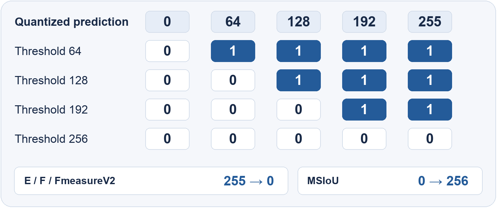
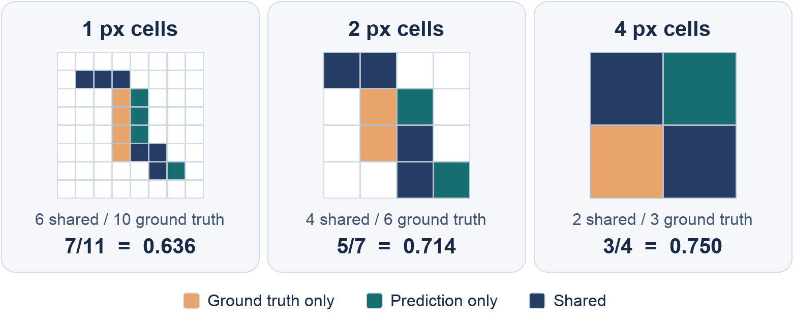
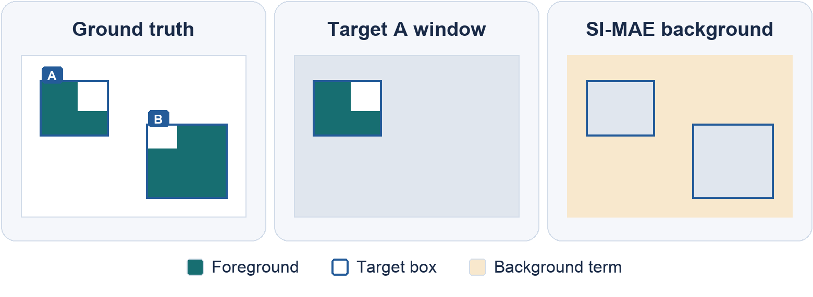

Supported Metrics
=================

See :ref:`metric-inputs` for the input format shared by the evaluators below.

.. _threshold-modes:

Overview
--------

Sample-based scores are calculated per image and then averaged across images. For
dynamic metrics, the usual ``max`` and ``avg`` summaries take the maximum or mean
of the averaged curve. See :ref:`size-invariant-metrics` for target-wise reductions.

Let :math:`P(x)` be the normalized prediction at pixel :math:`x` and
:math:`\overline P` its mean over the image. Adaptive and fixed binary modes use
the following foreground masks.

.. math::

   B_{\mathrm{adp}}(x) &= \mathbf{1}\!\left[P(x) \ge \min(2\overline P, 1)\right], \\
   B_{\mathrm{bin}}(x) &= \mathbf{1}\!\left[P(x) > 0.5\right].

Dynamic curves first quantize the prediction to 8 bits, then apply integer thresholds.

.. math::

   Q(x) &= \left\lfloor 255P(x) \right\rfloor, \\
   B_t(x) &= \mathbf{1}\!\left[Q(x) \ge t\right].

E-measure, legacy F-measure, and both FmeasureV2 evaluators return 256 points in
descending threshold order from 255 to 0. :ref:`msiou` returns 257 points in
ascending order from 0 to 256.

   A value equal to the threshold is foreground. At threshold 128, the last three
   pixels are foreground. MSIoU includes the endpoint at 256, where every pixel
   is background.

Basic Metrics
-------------

MAE (Mean Absolute Error)
~~~~~~~~~~~~~~~~~~~~~~~~~~

Measures the pixel-wise absolute difference between prediction and ground truth.

.. math::

   MAE = \frac{1}{W \times H} \sum_{x=1}^{W} \sum_{y=1}^{H} |P(x,y) - G(x,y)|

where :math:`P` is the prediction, :math:`G` is the ground truth, and :math:`W \times H` is the image size.

**Reference:**

Perazzi et al., "Saliency filters: Contrast based filtering for salient region detection", CVPR 2012

**Usage:**

.. code-block:: python

   from py_sod_metrics import MAE

   mae = MAE()
   mae.step(pred, gt)
   results = mae.get_results()
   print(f"MAE: {results['mae']:.4f}")

S-measure (Structure Measure)
~~~~~~~~~~~~~~~~~~~~~~~~~~~~~~

Evaluates structural similarity between prediction and ground truth, considering both region-aware and object-aware components.

.. math::

   S_m = \alpha \cdot S_o + (1 - \alpha) \cdot S_r

where :math:`S_o` is the object-aware structural similarity, :math:`S_r` is the
region-aware structural similarity, and :math:`\alpha` defaults to 0.5.

.. versionchanged:: 1.7.0
   Empty quadrants contribute zero to the region-aware score when the foreground
   centroid falls on the last row or column.

**Reference:**

Fan et al., "Structure-measure: A new way to evaluate foreground maps", ICCV 2017

**Usage:**

.. code-block:: python

   from py_sod_metrics import Smeasure

   sm = Smeasure()
   sm.step(pred, gt)
   results = sm.get_results()
   print(f"S-measure: {results['sm']:.4f}")

E-measure (Enhanced-alignment Measure)
~~~~~~~~~~~~~~~~~~~~~~~~~~~~~~~~~~~~~~~

Captures both local and global matching information between prediction and ground truth.

**Reference:**

Fan et al., "Enhanced-alignment Measure for Binary Foreground Map Evaluation", IJCAI 2018

**Usage:**

.. code-block:: python

   from py_sod_metrics import Emeasure

   em = Emeasure()
   em.step(pred, gt)
   scores = em.get_results()["em"]
   print(f"Adaptive E-measure: {scores['adp']:.4f}")
   print(f"Max E-measure: {scores['curve'].max():.4f}")
   print(f"Avg E-measure: {scores['curve'].mean():.4f}")

F-measure
~~~~~~~~~

Weighted harmonic mean of precision and recall. The ``beta`` parameter in
``Fmeasure`` and ``FmeasureHandler`` represents :math:`\beta^2` and defaults to
0.3. Use ``beta=1`` for F1.

.. math::

   F_\beta = \frac{(1 + \beta^2) \times Precision \times Recall}{\beta^2 \times Precision + Recall}

**Reference:**

Achanta et al., "Frequency-tuned salient region detection", CVPR 2009

The legacy ``Fmeasure`` evaluator is deprecated. It returns the threshold-indexed
precision and recall curves under ``pr``. Use :ref:`fmeasurev2` in new code.

.. code-block:: python

   from py_sod_metrics import Fmeasure

   fm = Fmeasure()
   fm.step(pred, gt)
   scores = fm.get_results()["fm"]
   print(f"Adaptive F-measure: {scores['adp']:.4f}")
   print(f"Max F-measure: {scores['curve'].max():.4f}")

Weighted F-measure
~~~~~~~~~~~~~~~~~~

A weighted version of F-measure that assigns different importance to different pixels based on their location.

**Reference:**

Margolin et al., "How to evaluate foreground maps?", CVPR 2014

**Usage:**

.. code-block:: python

   from py_sod_metrics import WeightedFmeasure

   wfm = WeightedFmeasure()
   wfm.step(pred, gt)
   results = wfm.get_results()
   print(f"Weighted F-measure: {results['wfm']:.4f}")

Advanced Metrics
----------------

.. _fmeasurev2:

FmeasureV2 Framework
~~~~~~~~~~~~~~~~~~~~

Pass one or more named handlers as ``metric_handlers``. Each handler takes
``with_dynamic`` and ``with_adaptive`` and can enable ``with_binary``. The result
maps each handler name to its enabled ``dynamic``, ``adaptive``, or ``binary`` scores.

``dynamic`` is a 256-point array averaged across images and ``adaptive`` is an
image-averaged scalar. For ``binary``, the default ``sample_based=True`` averages
per-image scores. With ``sample_based=False``, the handler computes the binary score
from confusion counts pooled across the dataset. For :math:`N` images, write
:math:`\mathbf c_i = (\mathrm{TP}_i, \mathrm{FP}_i, \mathrm{TN}_i, \mathrm{FN}_i)`
for the counts of image :math:`i` and :math:`f` for the handler.

.. math::

   s_{\mathrm{sample}} &= \frac{1}{N}\sum_{i=1}^{N} f(\mathbf c_i), \\
   s_{\mathrm{whole}} &= f\!\left(\sum_{i=1}^{N}\mathbf c_i\right).

If a four-pixel image is entirely correct and a twelve-pixel image is entirely
incorrect, their sample-based accuracy is 0.50 and their whole-based accuracy is
0.25. In ``FmeasureV2``, ``sample_based`` controls the binary result.

**Supported Handlers:**

* ``FmeasureHandler`` computes F-measure with configurable :math:`\beta^2`.
* ``PrecisionHandler``: Precision (Positive Predictive Value)
* ``RecallHandler``: Recall (Sensitivity, TPR)
* ``IOUHandler``: Intersection over Union
* ``DICEHandler``: Dice coefficient
* ``BERHandler``: Balanced Error Rate
* ``KappaHandler``: Cohen's Kappa
* ``OverallAccuracyHandler``: Overall classification accuracy
* ``SpecificityHandler``: Specificity (TNR)
* ``SensitivityHandler``: Sensitivity (same as Recall)
* ``FPRHandler``: False Positive Rate
* ``TNRHandler``: True Negative Rate
* ``TPRHandler``: True Positive Rate

**Usage:**

.. code-block:: python

   from py_sod_metrics import FmeasureV2, FmeasureHandler, IOUHandler

   fm_v2 = FmeasureV2(
       metric_handlers={
           "fm": FmeasureHandler(with_dynamic=True, with_adaptive=True, beta=0.3),
           "iou": IOUHandler(
               with_dynamic=False, with_adaptive=False, with_binary=True, sample_based=False
           ),
       }
   )

   fm_v2.step(pred, gt)
   results = fm_v2.get_results()
   max_fm = results["fm"]["dynamic"].max()
   binary_iou = results["iou"]["binary"]

Context-Measure
~~~~~~~~~~~~~~~

Designed specifically for camouflaged object detection, considering contextual information.

**Reference:**

Wang et al., "Context-measure: Contextualizing Metric for Camouflage", arXiv 2025

**Variants:**

* ``ContextMeasure`` computes :math:`C_\beta` from the prediction and mask.
* ``CamouflageContextMeasure`` computes :math:`C^\omega_\beta` and takes the aligned
  RGB image of shape ``(H, W, 3)`` via the keyword-only argument ``img``.

**Usage:**

.. code-block:: python

   from py_sod_metrics import ContextMeasure, CamouflageContextMeasure

   cm = ContextMeasure()
   ccm = CamouflageContextMeasure()

   cm.step(pred, gt)
   ccm.step(pred, gt, img=img)  # img is the RGB image aligned with gt
   cm_score = cm.get_results()["cm"]
   ccm_score = ccm.get_results()["ccm"]

.. _msiou:

Multi-Scale IoU (MSIoU)
~~~~~~~~~~~~~~~~~~~~~~~

Measures how well predicted edges cover ground-truth edges at multiple grid
resolutions. At level :math:`\ell`, each grid cell has a nominal side length
of :math:`2^\ell` pixels and is occupied if it contains an edge pixel. For
:math:`L` levels, let :math:`P_\ell` and :math:`G_\ell` be the sets of occupied
prediction and ground-truth cells at level :math:`\ell`.

.. math::

   r_\ell = \frac{|P_\ell \cap G_\ell| + 1}{|G_\ell| + 1},
   \qquad \ell = 0, \ldots, L-1.

MSIoU applies the trapezoidal rule over equally spaced levels. With :math:`L=1`,
it returns the original-resolution edge score :math:`r_0`. For :math:`L\ge 2`,

.. math::

   \operatorname{MSIoU}
   = \frac{\frac{1}{2}r_0 + \sum_{\ell=1}^{L-2} r_\ell
           + \frac{1}{2}r_{L-1}}{L-1}.

   In this example, the two edge maps are already extracted. The one-, two-, and
   four-pixel grids yield scores of approximately 0.636, 0.714, and 0.750, so the
   three-level MSIoU is approximately 0.704.

``num_levels`` accepts integers from 1 to 63. The default of 10 uses cell sizes of
1, 2, 4, ..., 512 pixels. With ``num_levels=1``, the evaluator returns the edge score
at the original resolution. A cell size that reaches an image dimension uses one
cell along that axis.

.. versionchanged:: 1.7.0
   Edge maps use ``float64`` to preserve precision when counting ground-truth edge
   pixels. The bundled regression samples have updated adaptive, mean, max, and
   binary scores. Custom grid configurations use consecutive powers of two from 1 pixel.

**Reference:**

Ahmadzadeh et al., "Multiscale IOU: A Metric for Evaluation of Salient Object Detection with Fine Structures", ICIP 2021

**Usage:**

.. code-block:: python

   from py_sod_metrics import MSIoU

   msiou = MSIoU(with_dynamic=True, with_adaptive=True, with_binary=True)
   msiou.step(pred, gt)
   results = msiou.get_results()

Human Correction Effort Measure
~~~~~~~~~~~~~~~~~~~~~~~~~~~~~~~~

Estimates correction effort from polygon control points and independent regions.
The evaluator thresholds the normalized prediction with ``pred > 0.5`` and returns
the mean per-image effort under ``hce``. Lower scores indicate less effort.

.. versionchanged:: 1.7.0
   Polygon approximation uses the historical OpenCV 4.12 behavior for integer contours.

**Reference:**

Qin et al., "Highly Accurate Dichotomous Image Segmentation", ECCV 2022

**Usage:**

.. code-block:: python

   from py_sod_metrics import HumanCorrectionEffortMeasure

   hcem = HumanCorrectionEffortMeasure()
   hcem.step(pred, gt)
   hce = hcem.get_results()["hce"]

.. _size-invariant-metrics:

Size-Invariant Metrics
----------------------

These evaluators use bounding boxes of 4-connected ground-truth components. They
select components of at least 50 pixels. If all components are smaller, they select
all components tied for largest. A mask with no foreground is scored as one image.

   Target A is evaluated on full-size arrays with zeros outside its box. For SI-MAE,
   the background term covers the pixels outside both target boxes.

.. versionchanged:: 1.7.0
   The size-invariant evaluators support all-foreground masks and more than 63
   targets. SI-MAE averages the target terms when their boxes cover the full image.

Size-Invariant FmeasureV2
~~~~~~~~~~~~~~~~~~~~~~~~~

``SizeInvarianceFmeasureV2`` uses the same named handlers as ``FmeasureV2``. For each
target, it zeros the prediction and mask outside the target box and evaluates the
resulting full-size arrays. Adaptive thresholds therefore use the mean over the
full-size masked prediction. Results are stored under the corresponding handler name.

* With ``sample_based=True``, ``dynamic`` is a list with one array per image of
  shape ``(num_targets, 256)``. For the sample-based max or mean, reduce each target
  curve over thresholds, average the target scores within each image, then average
  across images. Binary scores also average within each image, then across images.
* With ``sample_based=False``, ``dynamic`` is one 256-point curve averaged over all
  target curves across the dataset. Take its max or mean over thresholds. ``binary``
  is calculated from confusion counts summed over all targets.
* ``adaptive`` averages target scores within each image, then across images, for
  either setting of ``sample_based``.

**Reference:**

Li et al., "Size-invariance Matters: Rethinking Metrics and Losses for Imbalanced Multi-object Salient Object Detection", ICML 2024

**Usage:**

.. code-block:: python

   from py_sod_metrics import FmeasureHandler, SizeInvarianceFmeasureV2

   si_fm = SizeInvarianceFmeasureV2(
       metric_handlers={
           "fm": FmeasureHandler(with_dynamic=True, with_adaptive=True, sample_based=False)
       }
   )
   si_fm.step(pred, gt)
   scores = si_fm.get_results()["fm"]
   print(f"SI F-measure (avg over the pooled target curve): {scores['dynamic'].mean():.4f}")

Size-Invariant MAE
~~~~~~~~~~~~~~~~~~

Let :math:`U` be the union of the :math:`K` selected target boxes and
:math:`B` the region outside that union. For an image with selected targets,
let :math:`e_j` be the MAE inside target box :math:`j` and :math:`e_B` the
MAE over :math:`B`.

.. math::

   w_B = \frac{|B|}{|U|},
   \qquad
   \mathrm{SI\text{-}MAE}_{\mathrm{image}}
   = \frac{\sum_{j=1}^{K} e_j + w_B e_B}{K + w_B}.

When the boxes cover the whole image, the score is the mean of the target-box
errors. The reported ``si_mae`` averages the image scores.

**Usage:**

.. code-block:: python

   from py_sod_metrics import SizeInvarianceMAE

   si_mae = SizeInvarianceMAE()
   si_mae.step(pred, gt)
   score = si_mae.get_results()["si_mae"]

Metric Comparison Table
-----------------------

.. list-table::
   :header-rows: 1
   :widths: 35 37 28

   * - Evaluator
     - Sample-based modes
     - Whole-based modes
   * - MAE, S-measure, weighted F-measure
     - Continuous prediction
     - —
   * - Context-Measure and Camouflage Context-Measure
     - Continuous prediction
     - —
   * - Human Correction Effort
     - Fixed binary threshold
     - —
   * - Legacy F-measure and E-measure
     - Dynamic, adaptive
     - —
   * - Multi-Scale IoU
     - Dynamic, adaptive, binary
     - —
   * - FmeasureV2 handlers
     - Dynamic, adaptive, binary
     - Binary with pooled counts
   * - SizeInvarianceFmeasureV2 handlers
     - Target-wise dynamic, adaptive, binary
     - Target-averaged dynamic, binary with pooled counts
   * - SizeInvarianceMAE
     - Target boxes and background on continuous predictions
     - —
